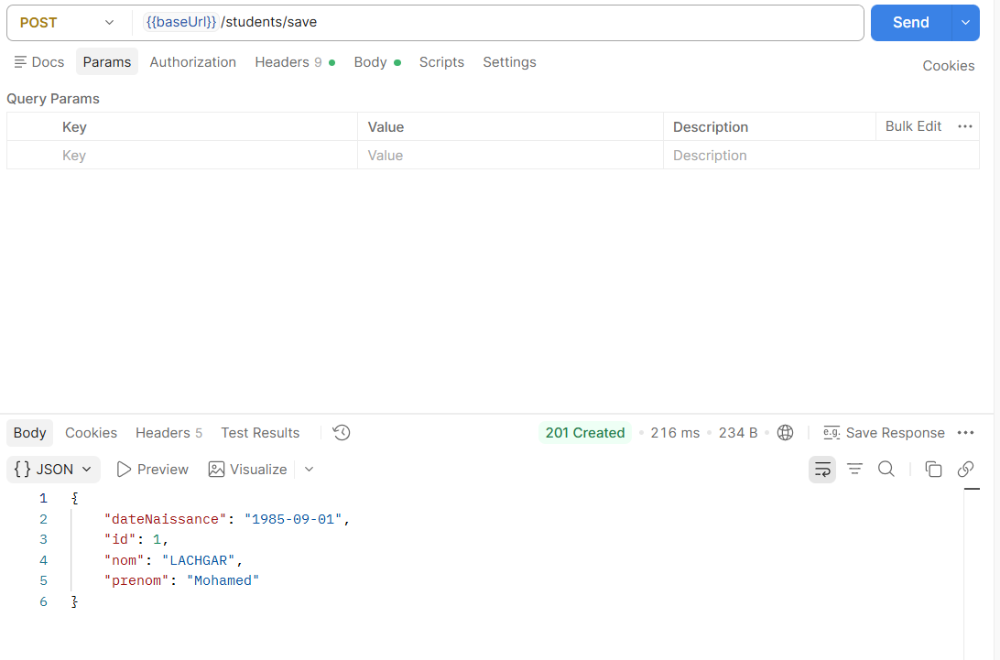
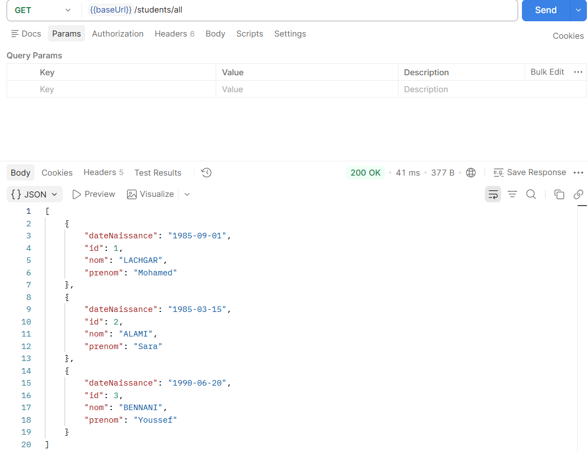
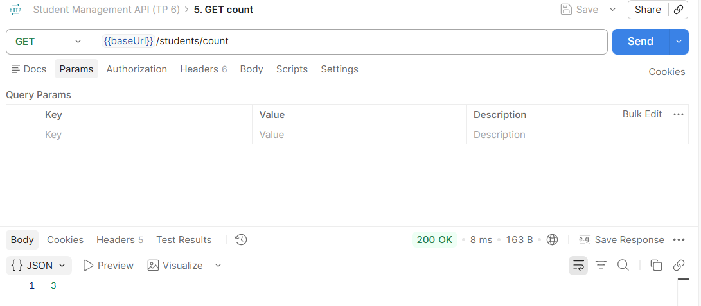
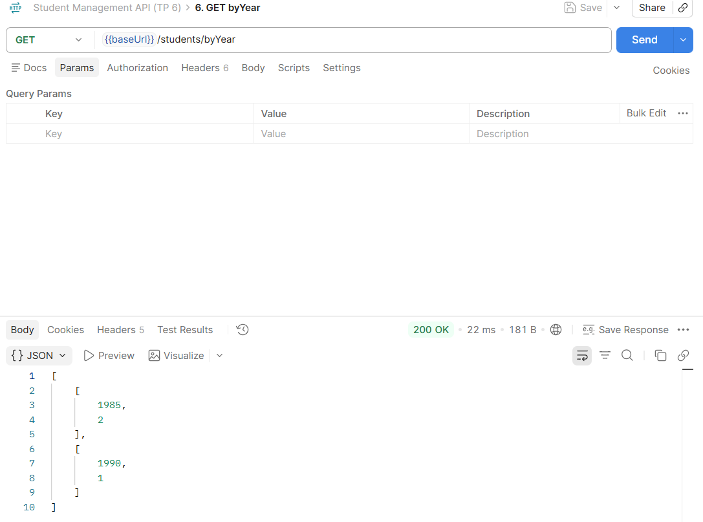
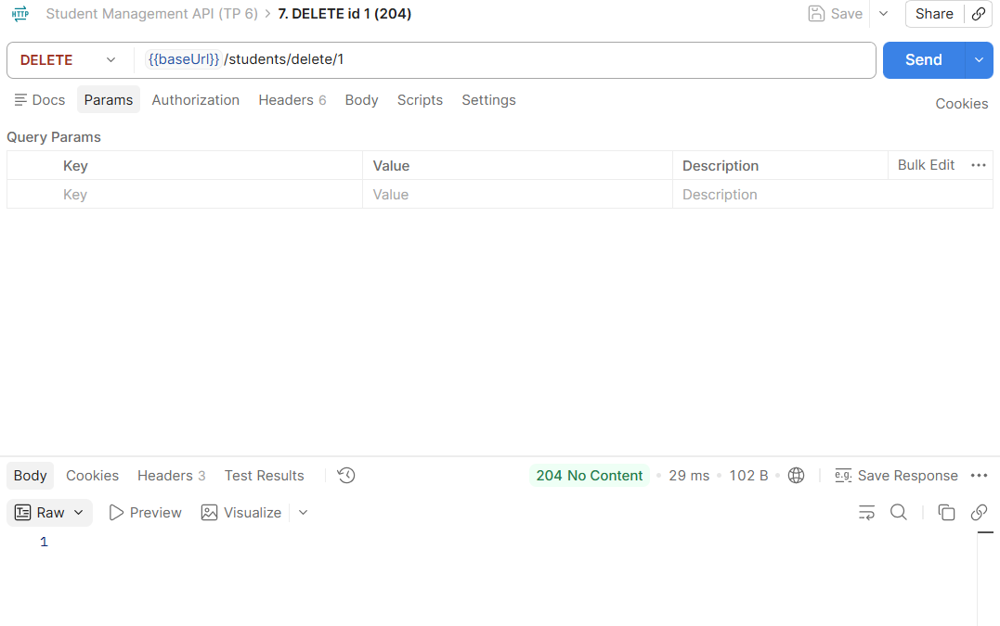
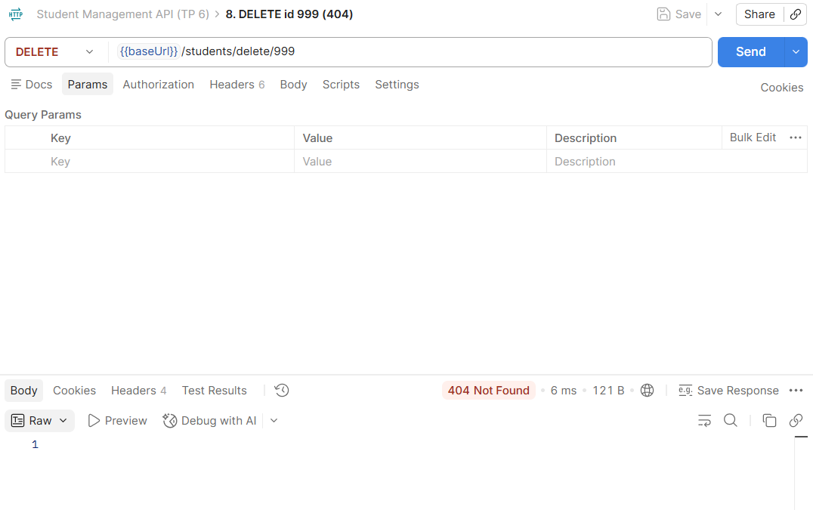
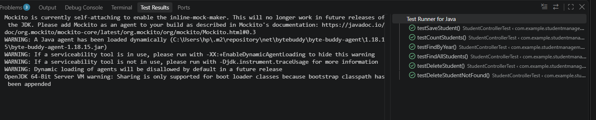
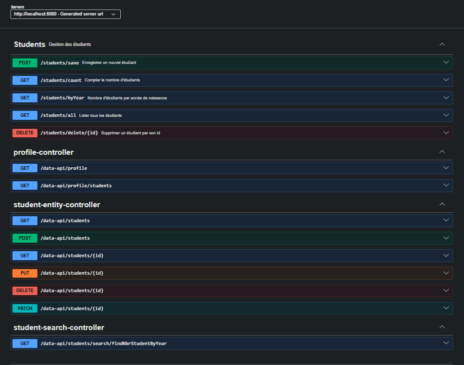

# TP 6 – Spring Boot et Swagger : documentation d'API microservices

API REST de gestion des étudiants (CRUD simplifié + statistiques par année de naissance), persistée dans MySQL et documentée avec Swagger / OpenAPI.

## Stack

| Élément | Version |
|---|---|
| Java | 21 |
| Spring Boot | 4.1.2 (Web MVC, Data JPA, Data REST, Validation, DevTools) |
| Base de données | MySQL 8 (driver `mysql-connector-j`) |
| Documentation | springdoc-openapi 3.2.0 (`springdoc-openapi-starter-webmvc-ui`) |
| Tests | JUnit 5 + Mockito |
| Build | Maven (wrapper `mvnw` fourni) |

## Structure

```
src/main/java/com/example/studentmanagement
├── StudentManagementApplication.java
├── config/OpenApiConfig.java        # métadonnées OpenAPI
├── controller/StudentController.java
├── entity/Student.java
├── repository/StudentRepository.java
└── service/StudentService.java
src/test/java/com/example/studentmanagement
└── StudentControllerTest.java       # tests unitaires du contrôleur
```

## Prérequis

- JDK 21 ou plus récent
- MySQL en écoute sur `localhost:3306`
- Maven n'est pas obligatoire : utilisez `./mvnw` (ou `mvnw.cmd` sous Windows)

## Configuration MySQL

La base est créée automatiquement au démarrage (`createDatabaseIfNotExist=true`), ou à la main :

```sql
CREATE DATABASE IF NOT EXISTS studentdb;
```

`src/main/resources/application.properties` :

```properties
spring.datasource.url=jdbc:mysql://localhost:3306/studentdb?serverTimezone=UTC&createDatabaseIfNotExist=true
spring.datasource.username=root
spring.datasource.password=
spring.jpa.hibernate.ddl-auto=update
spring.data.rest.base-path=/data-api
```

Adaptez `username` / `password` à votre installation. Avec `spring.data.rest.base-path=/data-api`, les endpoints générés par Spring Data REST ne sont pas en conflit avec ceux du contrôleur (`/students`).

## Lancement

```bash
./mvnw spring-boot:run
```

L'application démarre sur `http://localhost:8080` (log : `Started StudentManagementApplication`).

## Endpoints

| Méthode | URL | Corps | Code attendu |
|---|---|---|---|
| POST | `/students/save` | `{"nom":"LACHGAR","prenom":"Mohamed","dateNaissance":"1985-09-01"}` | 201 Created |
| DELETE | `/students/delete/{id}` | – | 204 No Content (404 si l'id n'existe pas) |
| GET | `/students/all` | – | 200 OK (liste des étudiants) |
| GET | `/students/count` | – | 200 OK (nombre d'étudiants) |
| GET | `/students/byYear` | – | 200 OK (ex. `[[1985,2],[1990,1]]`) |

Exemple :

```bash
curl -X POST http://localhost:8080/students/save \
  -H "Content-Type: application/json" \
  -d '{"nom":"LACHGAR","prenom":"Mohamed","dateNaissance":"1985-09-01"}'
```

## Tests

```bash
./mvnw test
```

Les tests unitaires (`StudentControllerTest`) mockent `StudentService` avec Mockito, ils n'ont donc pas besoin de base de données. Le test d'intégration `contextLoads` est désactivé (`@Disabled`) parce qu'il demande un MySQL actif.

## Documentation Swagger

- Swagger UI : http://localhost:8080/swagger-ui.html
- Spécification OpenAPI (JSON) : http://localhost:8080/v3/api-docs

## Captures d'écran

> Placez vos images dans `docs/screenshots/`.

### Tests Postman

Collection prête à importer : [docs/student-management.postman_collection.json](docs/student-management.postman_collection.json).
Partir d'une table `student` vide et exécuter dans l'ordre : les 3 POST, puis `all`, `count`, `byYear`, puis les DELETE (sinon `byYear` ne renvoie pas `[[1985,2],[1990,1]]`).








### Tests JUnit



### Swagger UI


